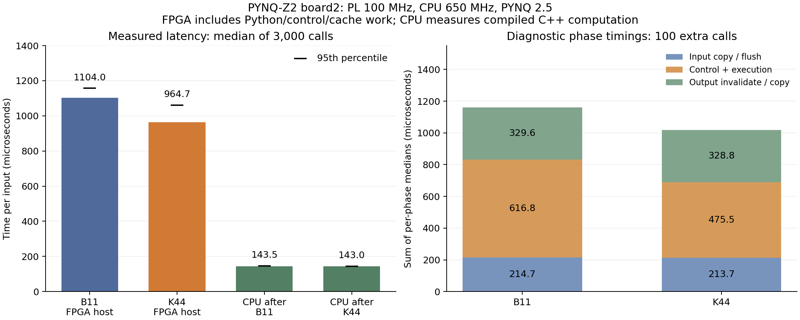

# ECE 506 FFN：board2 实板结果

测试日期：2026-11-18，Arizona 时间 15:25–15:28 为最终 audit3 测试。预约截止 16:00，测试已提前结束。

**B11、K44 均已通过实板功能与计时测试，正常释放缓冲区并停止测试 kernel。板子保持 operating，未发生板卡卡死或重启。**

环境：PYNQ-Z2 / pynq2，PL 100 MHz，CPU 650 MHz，PYNQ 2.5，Python 3.6.5，NumPy 1.13.3，GCC 7.3.0。CPU 编译参数 `-std=c++17 -O3`。未修改 CPU 频率、亲和性或系统调度；该镜像未暴露 cpufreq governor 文件。

## 正确性与测试量

- 每版通过初始状态/非法操作保护、单输入 smoke 和 9 套参数的 206 次正确性检查。
- 每版完成 20 次 warm-up 和 3×1000 次正式计时；3,000 个输出全部正确。
- 每版另做 100 次分阶段诊断，输出全部正确；这些数据不混入正式计时。
- 每个板端 CPU 测试先验证两层的全部 206 次推理，再记录 3,000 次计算。
- 最终 B11/K44 使用完全相同的 audit3 host 文件，两个 bit/HWH 与本地审查版本逐字节相同。

## 正式测量

所有时间单位为 μs。FPGA 行包含 Python host 输入复制/flush、寄存器写入/等待完成和 idle、输出 invalidate/复制；CPU 行是内存中数组上的 C++ 计算。LOAD、正确性比较与文件 I/O 均不在推理计时内。

| 路径 | 样本 | 中位数 | P95 | 最大值 |
|---|---:|---:|---:|---:|
| B11 FPGA host | 3000 | 1103.991 | 1157.015 | 1504.677 |
| B11 CPU（该组后测量） | 3000 | 143.499 | 146.283 | 203.455 |
| K44 FPGA host | 3000 | 964.715 | 1061.408 | 10314.825 |
| K44 CPU（该组后测量） | 3000 | 142.971 | 144.789 | 386.800 |

K44 相对 B11 的实板 host 中位延迟加速为 **1.144×**，延迟降低 **12.6%**。
它没有达到 HLS 核内的 10.89× 比例；K44 当前 host 路径耗时仍为其对应 CPU 计算的 **6.75 倍**。这不是 FPGA 算术本身慢于 CPU 的测量，而是当前完整 Python/FPGA 调用路径的结果。

三轮 FPGA 中位数：

- B11：1103.417, 1102.705, 1105.723 μs。
- K44：964.669, 968.777, 962.769 μs。

K44 有一次约 10.315 ms 的最大样本，全部原样保留。没有隔离 Linux 调度，不能把这次最大值解释成硬件最坏延迟，也不据此虚构异常原因。LOAD 时间另外保存，但只是单次/不同参数组的观测，不据此声称板上加载加速。

## 为什么核内改善大、端到端改善小

独立的 100 次诊断得到以下阶段中位时间；额外时间戳会改变测量开销，不能替换上面的正式结果，各阶段中位数之和也不必等于总体中位数。

| 阶段（μs） | B11 | K44 |
|---|---:|---:|
| 输入复制与 flush | 214.7 | 213.7 |
| 控制与执行 | 616.8 | 475.5 |
| 输出 invalidate 与复制 | 329.6 | 328.8 |

K44 输入和输出缓冲区处理合计约 542.5 μs，已经超过 CPU 计算时间。控制与执行阶段还包含 MMIO、轮询和真实硬件执行，本次没有板上 cycle counter，不能把这一段全部归为硬件计算或全部归为 Python。结果说明：后续若要追求端到端超过 CPU，应优先处理 host/缓存同步开销。编译型 host、减少重复寄存器写入等属于下一轮实验；批处理会改变当前 batch=1 的问题设定。

## 本次发现并修复的问题

1. 旧 NumPy 不支持向 `fromfile` 直接传 `Path`。第一次 B11 smoke 在参数文件读取处停止，尚未启动 LOAD。确认空闲后正常 close，改为显式字符串路径，并加入回归测试。
2. 原 host 误要求 `ap_done` 和 `ap_idle` 同一次读取同时出现。K44 在 random_506 的第 35 个输入读到 `0x0a` 后保守停止。随后只做诊断读取：连续 idle=`0x4`、返回状态 0、64 个输出全部匹配，确认已完成后退役该会话。修正版记住 clear-on-read 的 done，再等待独立的 idle；保留超时和异常保护。实际控制 RTL 的新增测试验证了该状态序列。

这两项均是 host 兼容/协议处理问题；没有更改 FPGA 计算逻辑或 bitstream。早期停止记录和 audit2 的 B11 完整通过记录保留在本地归档，不放入 Git；最终对比只采用共同 audit3 host 的重跑数据。**确认完成后的特殊退役不适用于真正的 MMIO 阻塞或未确认的 DMA 超时，不提供通用绕过保护的方法。**

## 证据与交付

- [汇总 CSV](board_results.csv)、[完整验证记录](board_results.json)。收集脚本校验样本序号、正确性、中位数/P95、ZIP/bit/HWH/host 哈希及正常关闭记录。
- [B11 原始证据](board2_20261118/B11/) 与 [K44 原始证据](board2_20261118/K44/)，包括 CSV、执行过的 notebook、环境、CPU 编译记录、阶段日志、分段诊断及结束状态。
- [可用部署包](../deploy/README.md)：只使用 audit3。构建时写入 ZIP 的 `board_tested=false` 保持原样，实板通过证明在独立的 `board_results.json`，按 ZIP 和 bit/HWH 哈希绑定。
- [完整英文 TeX 报告](../report/ffn_report.tex)，旧版报告保留在本地归档。只更新 TeX/PNG，没有生成报告 PDF。

复核命令：`python3 scripts/collect_board_results.py`。图表命令：`python3 scripts/plot_board_results.py`（需要项目绘图库）。本次仅一个板卡、一次预约、同一次 Linux boot；不将结果推广为所有板卡的可靠性、功耗或最坏时延保证。
